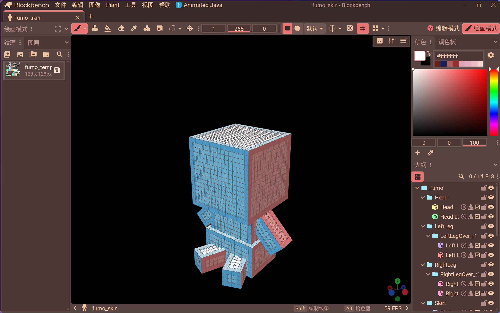
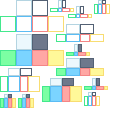

# Fumo 皮肤 / Fumo Skin

简体中文 | [English](README.en.md)

> 用画 Minecraft 皮肤的方式，画 Fumo 玩偶的贴图。

**免责声明**
本插件是非官方社区工具，与 Fumo 模组作者 KosherKomeiji、东方 Project 权利方 ZUN、以及 Blockbench 官方均无关联。

---

## 功能

- 一键生成完整 Fumo 模型：12 个分组、14 个立方体，几何数据来自模组的 `ModelFumo`
- 生成逐面着色的空白模板纹理（128×128 像素，UV 空间 64×64）
- **编辑 → 切换皮肤叠层**：在本体层与外壳层之间切换，方便分层绘制
- 也可以上传自己的 PNG 作为纹理
- 创建后自动进入绘画模式，复用 Blockbench 的画笔、调色板、取色器
- 跟随 Blockbench 语言：`zh` / `zh_tw` 使用中文，其余语言使用英文
- 仅桌面版；只使用公开 API，不读写磁盘、不发网络请求、不写存储

## 安装

1. 从 [Releases](../../releases) 下载 `fumo-skin-0.1.0.zip` 并解压（或同时下载 `fumo_skin.js` 与 `fumo_icon.png`）
2. Blockbench → 文件 → 插件 → 从文件加载插件，选中 `fumo_skin.js`
3. 保持 `fumo_icon.png` 与 `fumo_skin.js` 在同一目录，插件列表才会显示图标

要求 Blockbench 5.2.2 或更高版本，已在 5.2.2 桌面版（Windows）验证。

注意：`min_version` 指的是 Blockbench 的版本，不是插件版本。低于 5.2.2 的 Blockbench 会拒绝加载本插件。

## 使用

1. 首页「Fumo 皮肤」卡片 → 新建
2. 选择「生成模板」或「上传 PNG」
3. 在绘画模式下绘制；名称含 `Layer` 的立方体是外壳层
4. 导出：在纹理面板右键 → 另存为 → PNG

## 用到游戏里

把导出的 PNG 放进你自己的资源包：`assets/fumo/textures/entities/<你的名字>.png`。
建议用自己的文件名并通过资源包叠加，不要直接覆盖模组 jar 里的原画——那是 reimuu 的美术作品。

## 纹理精度

默认模板是 128×128（64×64 UV 空间的 2 倍）。256×256 的 PNG 也可以使用：UV 仍按 64×64 解释，原理与 Minecraft 的 HD 皮肤相同。不是 64 整数倍的尺寸可能触发 Blockbench 的分辨率提示。

## 截图

## 许可与署名

- **插件**：[CC BY-NC-SA 4.0](https://creativecommons.org/licenses/by-nc-sa/4.0/) —— 版权归 hemekewayoshino（2026）所有。
- **上游作品**：*Fumo-Mcreator*，作者 **KosherKomeiji**（credits: MCreator, reimuu），https://github.com/KosherKomeiji/Fumo-Mcreator ，同为 CC BY-NC-SA 4.0。
- **修改说明**：上游几何为 Java 源码，本插件将其逆向转换为 Blockbench 预设；分组命名、外壳层 `Layer` 后缀与叠层切换为本插件新增，不属于上游内容。
- **使用条件**：再分发必须保留上述署名，不得用于商业用途，衍生版本须以同一许可证发布。
- **美术素材**：本插件不打包任何第三方美术；你自己绘制的贴图版权归你。
- **图标**：hemekewayoshino，CC BY-NC-SA 4.0，随本插件一同发布。
- **担保**：本作品按"现状"提供，不附带任何明示或暗示的担保。

## 已知限制

- 仅支持桌面版，网页版未适配也未测试
- 要求 Blockbench 5.2.2 或更高版本
- 叠层切换依据「方块名包含 `Layer`」判定，重命名这些方块会导致切换失效
- 界面语言在插件加载时确定；切换 Blockbench 语言后若文案未更新，重新加载插件即可
- 可导出 glTF/GLB 给 Blender，但分组只会成为节点或空物体，不会自动变成骨骼；本格式没有动画模式，导出不含动画
- 只负责画贴图，不导出模组工程；产出是 PNG 与 `.bbmodel`

## 更新日志

见 [CHANGELOG.md](CHANGELOG.md)。
